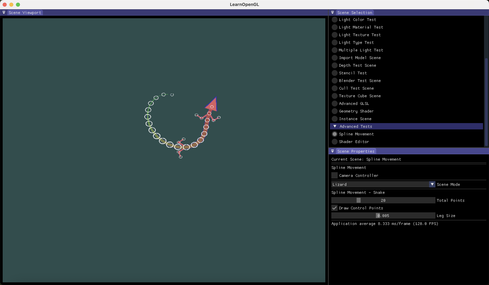
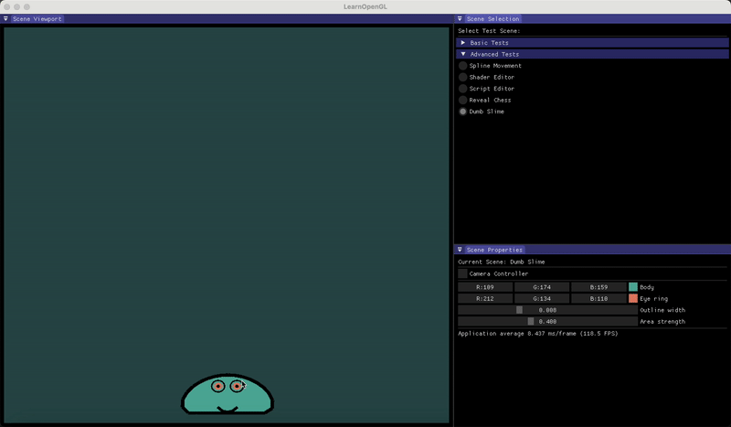
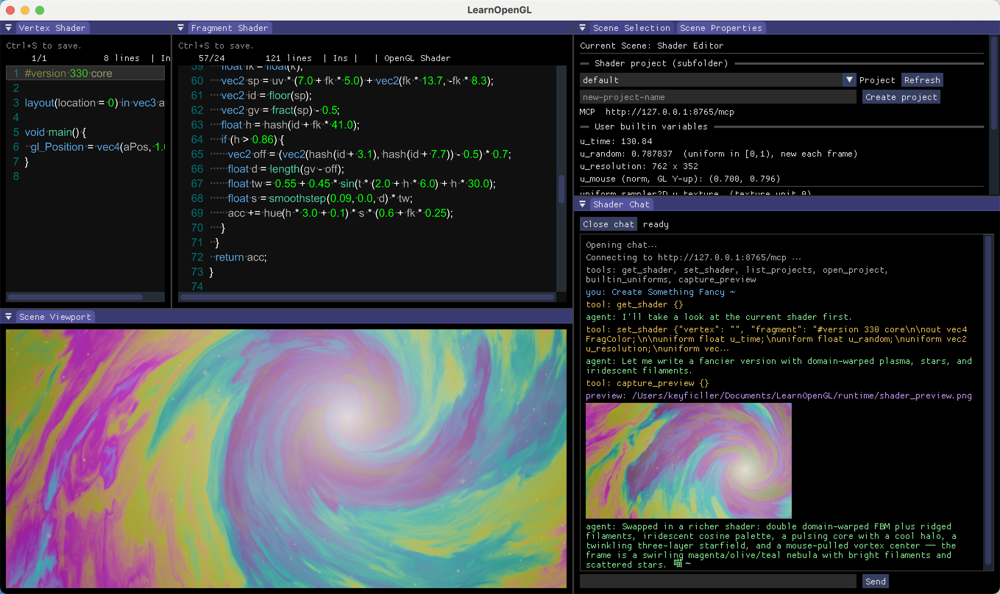
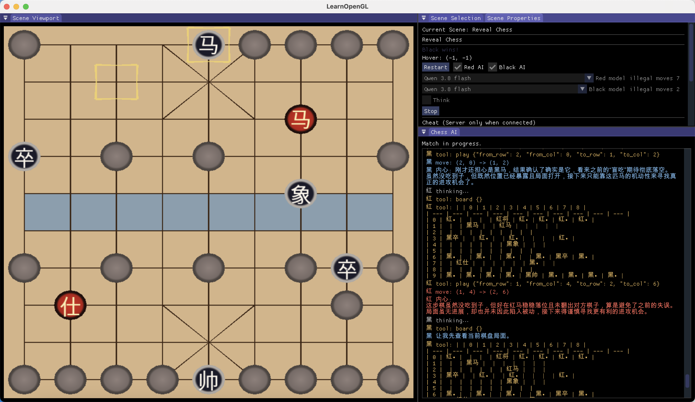
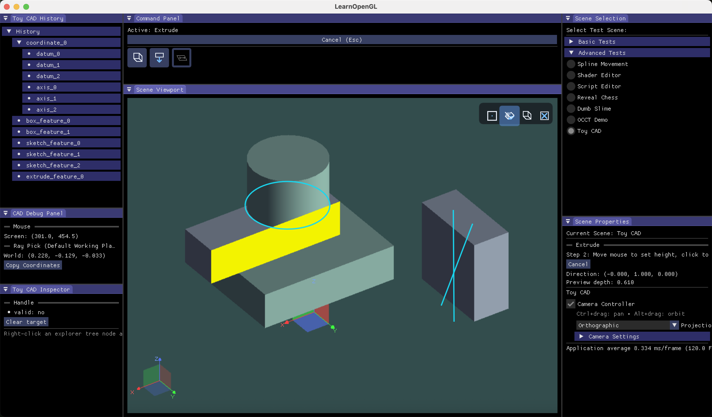

# LearnOpenGL Test Suite

OpenGL / ImGui experiments (spline motion, soft body, ShaderToy-like editor, chess, toy CAD).

## Build

### Prerequisites

- **CMake** 3.25+ (presets), Ninja or Unix Makefiles
- **clang-p2996** (P2996 static reflection), with reflective libc++:
  - `<CPPREF_LLVM_ROOT>/bin/clang++`
  - `<CPPREF_LLVM_ROOT>/include/c++/v1/meta`
  - `<CPPREF_LLVM_ROOT>/lib` (runtime / rpath)
- Network access to GitHub for FetchContent deps (GLFW, GLAD, …), or git `url.insteadOf` mirrors via your local preset

Set the toolchain prefix with either:

```bash
export CPPREF_LLVM_ROOT=/path/to/llvm-p2996
# or: cmake -DCPPREF_LLVM_ROOT=/path/to/llvm-p2996 ...
```

### Submodules

This repo vendors a modified [ImGuiColorTextEdit](https://github.com/KeyFicller/ImGuiColorTextEdit) under `vendor/ImGuiColorTextEdit`. Initialize it after clone:

```bash
git submodule update --init --recursive
```

Or clone with submodules in one step:

```bash
git clone --recurse-submodules https://github.com/KeyFicller/LearnOpenGL.git
```

Without the submodule, CMake configures with a warning and the shader editor path that needs `TextEditor.h` will not build cleanly.

### Configure and build

```bash
# one-time: machine-local preset (gitignored)
cp CMakeUserPresets.json.example CMakeUserPresets.json
# edit CPPREF_LLVM_ROOT (and optional LEARNOPENGL_OCCT_BUILD_DIR) inside CMakeUserPresets.json

cmake --preset local
cmake --build --preset local
```

`CMakePresets.json` `default` also works if `CPPREF_LLVM_ROOT` is already in the environment.

### Optional Open CASCADE (Toy CAD)

OCCT is off by default. Prefer filling `LEARNOPENGL_OCCT_BUILD_DIR` in your gitignored `CMakeUserPresets.json` (see the example file) so each machine keeps its own path. The value must be the OCCT *build* tree that contains `OpenCASCADETargets.cmake`. Leave it empty to keep OCCT disabled.

One-shot override without editing the preset:

```bash
cmake --preset local -DLEARNOPENGL_OCCT_BUILD_DIR=/path/to/OCCT/build
```

### Python agents (Shader Chat / Reveal Chess)

The in-app chat panels spawn a **project-local** interpreter (after `resource_root` chdirs to the repo). Resolution order:

1. `LEARNOPENGL_PYTHON` if set and the path exists
2. `.venv/bin/python` or `.venv/bin/python3` (Unix)
3. `.venv/Scripts/python.exe` (Windows layout)

```bash
python3 -m venv .venv
source .venv/bin/activate          # Windows: .venv\Scripts\activate
pip install -r scripts/shader_agent/requirements.txt
pip install -r scripts/chess_agent/requirements.txt
cp .env.example .env               # fill API keys used by the agents
```

Override when the venv lives elsewhere:

```bash
export LEARNOPENGL_PYTHON=/path/to/python
```

The launchers use POSIX `fork`/`pipe` today, so the in-app panels target macOS/Linux; the Windows `.venv\Scripts\…` probe is for shared trees and a future CreateProcess path.

## Spline movement program animation

## Soft body animation

## Shader editor（like ShaderToy）

## Reveal chess

## Toy CAD
